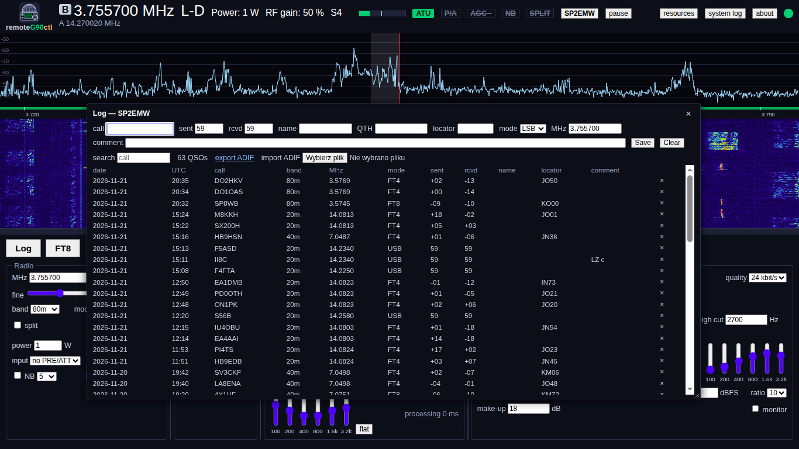
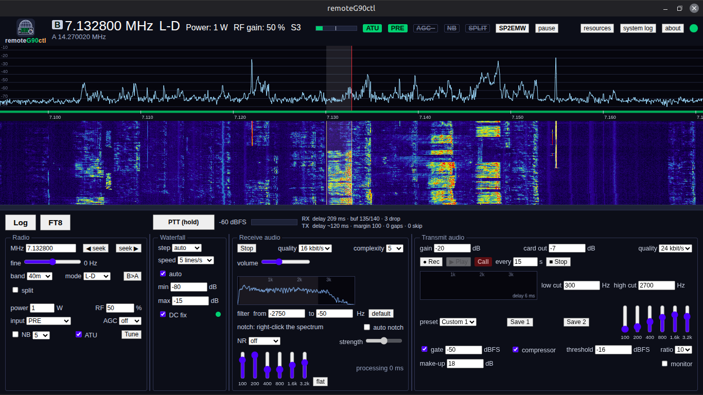
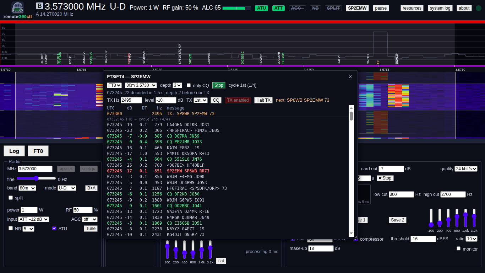

# remoteG90ctl

**English** · [Polski](README.pl.md)

Operate a **Xiegu G90** from a web browser — from the shack, from the sofa, or
from the other end of the country over a phone connection. A small Linux box
sits next to the radio; you open a page and get the waterfall, audio both
ways, the controls, FT8/FT4 and a log.

> **This is a development version (0.x).** It runs with my own G90, but
> FT8/FT4 transmission has not been tested on the air yet, and I have exactly
> one G90 to test on. Read [Safety](#safety-and-the-risk-that-remains) before
> you let it key your transmitter.

## Why I built it

I am building an **energy-efficient, solar-powered remote station**: a G90 and
a low-power computer (a fanless Fujitsu Futro S740 at the moment) somewhere
with a good antenna, power from a panel and a battery, and internet over LTE.
I wanted to:

- operate it from a laptop or a phone, without remote desktops or a pile of
  programs on the client side — just a browser;
- see the band, not only hear it — the G90 has a factory I/Q output, so a
  proper wideband waterfall;
- keep the traffic small enough for a mobile connection;
- above all, **not worry that the radio keeps transmitting** when the phone
  loses signal, the laptop goes to sleep or the program crashes. Nobody is
  standing next to a remote station to pull the plug.

I couldn't find anything that did all of this for the G90, so this project
happened. The build of the station itself will be documented here too, as it
progresses.

The program is shaped by the hardware I actually have: a G90 with firmware
1.81, a Xiegu DE-19 interface (PTT on its RTS line, audio through its sound
card), the radio's I/Q output into a second USB sound card, a Futro S740 and
an LTE modem. What it does, what it leaves out and many of its limits follow
from that set and from measurements on this one radio. Other radios are not
supported; another interface or computer may work, but I have not tested it.
The parts and the wiring are in [docs/hardware.md](docs/hardware.md).

## Design principles

- **Safety first.** When in doubt, the program does not transmit. Everything
  that can key the radio sits in one small, separate process, and it does not
  trust anybody — including the rest of this program.
- **The browser is the client.** Nothing to install on a laptop or a phone.
- **Built for weak links.** Opus audio, a waterfall you can slow down or
  switch off, nothing sent that nobody is looking at.
- **Measured, not guessed.** The G90 implements only part of Icom's CI-V, and
  the documentation is thin. Every command was checked on the radio before
  the program was allowed to send it.
- **Private network only.** The server never faces the internet directly;
  remote access goes through a VPN (Tailscale) and HTTPS. Never use
  `tailscale funnel`: the page refuses requests that come without a tailnet
  identity.

## What it can do

- **Waterfall** from the radio's I/Q output, about ±40 kHz around the dial,
  with click-to-tune, zoom and the IARU band plan on top.
- **Radio control:** frequency, mode (including the data modes U-D/L-D), VFO
  A/B and split, RF power setting, the antenna tuner, preamp/attenuator, AGC, noise
  blanker, RF gain; S-meter. Power and SWR are shown only as indicators —
  "transmitting" and "high SWR" — not as measurements (see below).
- **Audio both ways:** listen in the browser, talk through the browser's
  microphone with push-to-talk.
- **Audio processing in the browser:** filters, manual and automatic notch,
  noise reduction for receive; filters, equaliser, compressor, noise gate and
  presets for transmit; record a CQ and let it call for you.
- **FT8/FT4:** decoding in the browser, QSOs sequenced like in WSJT-X.
- **A station log** per account, with ADIF import and export.
- **Seek:** jump to the next station up or down, found in the waterfall.
- **Accounts:** you log in with your callsign; one operator at a time. The
  first account is the administrator: it can restart the server from the page
  and, with an explicit click, take the station over from another account.
- **A command-line tool** on the server for status, CAT and tests, and a setup
  wizard (English or Polish) that walks you through the hardware checks.

### Screenshots

Taken on the owner's station (a G90 on 80 and 40 m, the server on a Fujitsu
Futro S740, November 2026).



*Listening to SSB on 80 m, with the station log open.*



*The whole page, on 40 m: waterfall, PTT with the receive and transmit audio
state, and the settings in columns — radio, waterfall, receive audio
processing and the transmit chain.*



*FT8 on 80 m: decodes over the spectrum and in the list, a QSO in progress —
the red bar shows the radio transmitting.*

## What it can't do (yet, or ever)

Some limits come from the G90 itself and what it exposes over CI-V, some from
the hardware around it, some are simply not done yet. The details and the
numbers are in [docs/g90-measurements.md](docs/g90-measurements.md) and
[docs/civ-g90.md](docs/civ-g90.md).

**Limits of the radio and its CI-V:**

- **No real power or SWR measurement.** Over CI-V the power meter reaches the
  end of its scale at about 3 W and the SWR meter at about 2.0, so the program
  uses them only to see that the radio transmits and to warn about high SWR.
  For real numbers, use an external meter. The SWR reading is rough even
  below that: the scale is non-linear and was checked against the radio's own
  display only, on one antenna.
- **No confirmation that the tuner found a match.** The radio does not report
  the result of a tuning, and the program does not check it: the "high SWR"
  warning comes only on the next transmission, and only once SWR reaches
  about 2. **Use a good, proven antenna** that the G90's tuner matches easily
  on the bands you work, and check it on site with an external SWR meter
  before you rely on tuning from afar.
- **The radio cannot say whether it is transmitting**, and its VOX state
  cannot be read. If VOX is on, any sound at the radio's audio input transmits
  past every protection of this program — so **VOX must be off**.
- **Opening the serial port keys the radio for a split second.** The kernel
  raises the PTT line before the program can lower it. It happens only when
  the guard starts or reopens the port; start it with the radio in SSB, on a
  dummy load or an antenna.
- **No remote power-on.** There is no CI-V command for it, and the G90 forgets
  its settings when DC is cut without switching it off first.
- **Antenna tuning cannot be stopped** once it starts: 1–1.5 s with a
  matched antenna, about 9 s measured with a poor match. The guard holds
  every other transmission and change of the radio until the radio's power
  meter shows the carrier has ended.
- **The radio's mic gain does not affect audio from the DE-19**, its speech
  compressor cannot be controlled over CI-V, and its menu settings (RX filters
  and so on) do not answer over CI-V. That's why the audio processing lives in
  the browser.
- **The waterfall goes blind while you transmit** — the I/Q output does not
  carry your own signal.

**Limits of the setup and of this project:**

- The waterfall covers about ±40 kHz, and without correction strong signals
  leave a faint mirror image (about 31–37 dB down).
- Over the internet there is always some audio delay; how much depends on
  your link.
- G90 only, Linux only. No CW, no digital modes other than FT8/FT4, no
  WSJT-X/`rigctld` integration — all by choice.
- Not done yet: FT8/FT4 transmission tested on the air, LoTW upload, the
  complete hardware checklist on the final remote setup.

## Safety, and the risk that remains

This program keys a transmitter, often with nobody next to it. That shaped the
whole design:

- Only one small process, the **guard**, may open the serial port and key the
  radio. Everything the rest of the program sends to the radio goes through an
  allowlist; nothing that transmits is on it.
- Transmitting is a **lease** that your browser renews every half second. Two
  seconds without a renewal — closed tab, lost signal, crashed program — and
  the radio goes back to receive.
- One transmission lasts **at most 180 s**, and then needs an explicit unlock.
  At most **300 s of transmitting in any 10 minutes**. These limits survive
  restarts.
- If the guard hangs, systemd kills it and the kernel drops the PTT line.
- No audio reaches the radio outside a lease, the browser may transmit only
  inside the amateur bands of your ITU region, and power is capped by the
  configuration.

**And still: the risk is not zero.** The G90 has no transmit time-out of its
own, and there is no hardware timer on the PTT line — all of the protection is
software. Software has bugs; a USB driver can hang in a way no watchdog can
fix; VOX bypasses everything. Start with a dummy load and low power, keep an
eye on the radio during the first sessions, and remember that **you are
responsible for every transmission made with your callsign.** The program
comes with no warranty (see the licence).

The rules and the reasoning behind them: [AGENTS.md](AGENTS.md) (section 2)
and [docs/decisions.md](docs/decisions.md). Reporting a safety problem:
[SECURITY.md](SECURITY.md).

## How this project was made

The idea, requirements, architecture and safety rules — the transmit lease,
time limits, the separate guard process — are mine, as are all measurements
and tests on a real G90. The code, most of the documentation and the logo
were made by an AI model (Claude, Anthropic) following those rules, and are checked by an
automated test suite and on the radio before each release. The model was given
ideas from other projects, not their code; since it may have seen their public
code in training, the code was compared with theirs before publishing
([docs/third-party.md](docs/third-party.md)).

## Getting started

**You need:**

- a Xiegu G90 (tested with firmware 1.81);
- a **Xiegu DE-19** interface, connected as its manual shows: the jack cable
  from the radio's front panel to the DE-19's CI-V socket, and the multi-pin
  DIN cable from the radio's rear ACC socket to the DE-19's ACC socket; the
  DE-19's USB goes to the computer;
- a second USB sound card on the radio's I/Q output (for the waterfall) that
  records **stereo at 96 kHz** — mine is a StarTech.com ICUSBAUDIO2D
  (C-Media chip, USB ID `0d8c:8810`; Linux calls it "Speed Dragon USB
  Advanced Audio Device"), with the I/Q output in its stereo mic input. At 96 kHz the waterfall shows about ±40 kHz; a 48 kHz
  card works too, with about ±22 kHz;
- a computer running Debian 12/13, Ubuntu 22.04+, Raspberry Pi OS (64-bit) or
  DietPi, on x86_64 or 64-bit ARM.


The IO/User socket is on the side of the front panel, below the headphone
socket, marked with a person in a circle.

Switch VOX off in the radio's menu, set the transmit power to the minimum,
then in a terminal on that computer:

```sh
curl -fsSL https://raw.githubusercontent.com/SP2EMW/remoteG90ctl/main/install.sh | sudo bash
```

It installs the newest **release**, not the development branch `main`. A
release with a plain number (`v1.2.3`) has passed the hardware checklist on a
real G90; while there is none, the installer takes the newest candidate
(`…rc1`) and says so. Running it again updates to the newest release.

The installer sets the program up as system services and then opens the setup
wizard in the same terminal. To run the wizard again later:

```sh
sudo remoteg90ctl setup
```

The wizard finds the DE-19 and the I/Q card, walks you through the hardware
checklist (with test transmissions on a dummy load or 1 W), asks for the power
limit, and — if you want remote access — sets up Tailscale. Transmitting stays
off until you allow it. Then open `http://127.0.0.1:8078` on the computer
itself, or the `https://…ts.net` address the wizard shows, and **create the
administrator account right away**.

### From another computer in your home network

The page listens only on the radio computer itself (`127.0.0.1`). Besides
Tailscale, there are two ways to reach it from another computer at home.
**I have not tested either of them yet** — treat them as hints, not as
instructions.

- **SSH tunnel (simplest).** On your laptop run

  ```sh
  ssh -N -L 8078:127.0.0.1:8078 user@radio-computer
  ```

  and open `http://localhost:8078` there. The browser treats `localhost` as
  secure, so the microphone works without a certificate. Keep the local port
  at 8078 (the same as `listen` in the configuration), otherwise the page
  refuses the request. When the tunnel drops, the page loses its connection
  and any transmission stops.
- **Your own HTTPS proxy** (for example Caddy) on the radio computer, under a
  name such as `g90.lan`, forwarding to `127.0.0.1:8078`. In the
  configuration: `allowed_hosts = ["g90.lan"]` and
  `require_tailnet_identity = false`. Every device then needs to trust the
  proxy's certificate, or the browser will not give the page the microphone.
  The page becomes reachable from every network that computer joins, with
  only the station login in the way — and do not put a `…ts.net` name in
  `allowed_hosts` with this setting.

Everything step by step, including manual installation, updates, backups and
removal: [docs/install.md](docs/install.md) (in Polish:
[docs/install.pl.md](docs/install.pl.md)). All settings are explained in
[config/example.toml](config/example.toml).

## Documentation

| | |
|---|---|
| [docs/install.md](docs/install.md) ([Polish](docs/install.pl.md)) | installation, the hardware checklist, remote access, backups |
| [docs/g90-measurements.md](docs/g90-measurements.md) | what was measured on the G90, the DE-19 and the I/Q card |
| [docs/civ-g90.md](docs/civ-g90.md) | the G90's CI-V commands and which ones the program uses |
| [docs/hardware.md](docs/hardware.md) | the hardware it was built and tested with: G90, DE-19, the I/Q sound card, Futro S740 with DietPi |
| [docs/decisions.md](docs/decisions.md) | why things are the way they are |
| [docs/server-protocol.md](docs/server-protocol.md), [docs/guard-protocol.md](docs/guard-protocol.md) | protocols of the server and the guard |
| [docs/third-party.md](docs/third-party.md) | code and ideas taken from other projects |
| [CHANGELOG.md](CHANGELOG.md) | what changed in each version |

## Contributing

Reports from other G90 owners are the most valuable thing you can send —
different firmware, a different interface, a measurement that disagrees with
mine. Bug reports and pull requests are welcome too; please read
[CONTRIBUTING.md](CONTRIBUTING.md) first, because anything that touches
transmitting follows stricter rules. Development setup:

```sh
uv sync && uv run pytest        # tests run on a built-in radio simulator, never on a real radio
```

## Licence

GPL-3.0-or-later — see [LICENSE](LICENSE).
