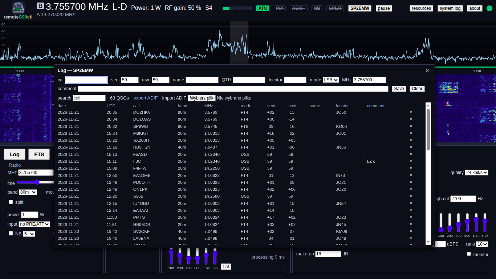
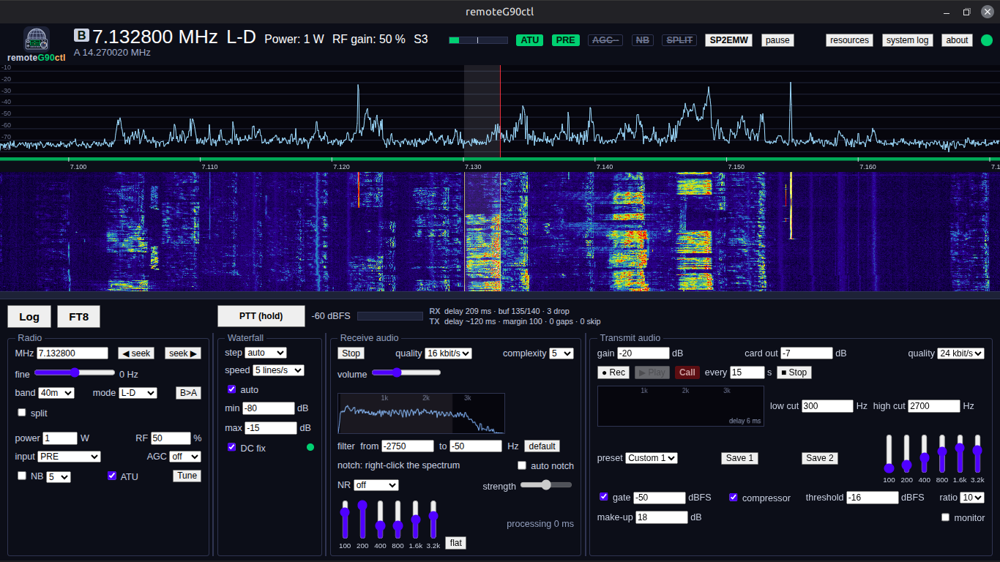
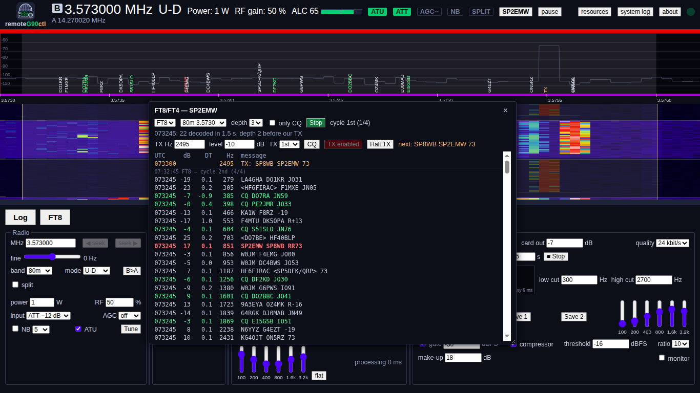
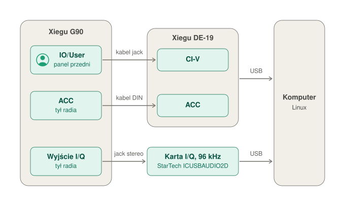

# remoteG90ctl

[English](README.md) · **Polski**

Obsługa **Xiegu G90** z przeglądarki — z shacku, z kanapy albo z drugiego
końca kraju przez internet w telefonie. Przy radiu stoi mały komputer z
Linuksem; otwierasz stronę i masz wodospad, dźwięk w obie strony, sterowanie,
FT8/FT4 i dziennik łączności.

> **To wersja rozwojowa (0.x).** Działa z moim G90, ale nadawanie
> FT8/FT4 nie było jeszcze sprawdzone na antenie, a do testów mam dokładnie
> jedno G90. Zanim pozwolisz jej kluczować swój nadajnik, przeczytaj
> [Bezpieczeństwo](#bezpieczeństwo-i-ryzyko-które-zostaje).

Instrukcja instalacji jest po polsku; reszta szczegółowej dokumentacji w
katalogu `docs/` — po angielsku.

## Po co mi to

Buduję **energooszczędną stację zdalną zasilaną energią słoneczną**: G90 i komputer o
małym poborze mocy (na razie bezwentylatorowy Fujitsu Futro S740) w miejscu z
dobrą anteną, prąd z panelu i akumulatora, internet przez LTE. Chciałem:

- pracować z laptopa albo telefonu, bez zdalnego pulpitu i bez stosu programów
  po stronie klienta — tylko przeglądarka;
- widzieć pasmo, a nie tylko je słyszeć — G90 ma fabryczne wyjście I/Q, więc
  porządny szerokopasmowy wodospad;
- zmieścić się w łączu komórkowym;
- a przede wszystkim **nie martwić się, że radio dalej nadaje**, kiedy
  telefon zgubi zasięg, laptop zaśnie albo program się wysypie. Przy stacji
  zdalnej nikt nie stoi, żeby wyciągnąć wtyczkę.

Nie znalazłem niczego, co robiłoby to wszystko dla G90, więc powstał ten
projekt. Budowę samej stacji też będę tu opisywać, w miarę postępów.

Kształt programu wynika ze sprzętu, który mam: G90 z firmware 1.81, interfejs
Xiegu DE-19 (PTT linią RTS, dźwięk przez jego kartę dźwiękową), wyjście I/Q
radia do drugiej karty dźwiękowej USB, Futro S740 i modem LTE. To, co program
robi, czego nie robi, i wiele jego ograniczeń wynika z tego zestawu i z
pomiarów na tym jednym egzemplarzu radia. Inne radia nie są obsługiwane; z
innym interfejsem albo komputerem program może działać, ale tego nie
sprawdzałem. Części i połączenia są w [docs/hardware.md](docs/hardware.md)
(po angielsku).

## Założenia

- **Najpierw bezpieczeństwo.** W razie wątpliwości program nie nadaje.
  Wszystko, co może kluczować radio, siedzi w jednym małym, osobnym procesie,
  który nikomu nie ufa — także reszcie tego programu.
- **Klientem jest przeglądarka.** Na laptopie ani telefonie nic nie trzeba
  instalować.
- **Pod słabe łącza.** Dźwięk w Opus, wodospad, który można spowolnić albo
  wyłączyć, i nic nie jest wysyłane, jeśli nikt na to nie patrzy.
- **Zmierzone, nie zgadywane.** G90 obsługuje tylko część CI-V Icoma, a
  dokumentacja jest skąpa. Każde polecenie zostało sprawdzone na radiu, zanim
  program dostał pozwolenie, żeby je wysyłać.
- **Tylko sieć prywatna.** Serwer nigdy nie wystawia się wprost do internetu;
  dostęp zdalny idzie przez VPN (Tailscale) i HTTPS. Nigdy nie używaj
  `tailscale funnel`: strona odrzuca żądania bez tożsamości z tailnetu.

## Co potrafi

- **Wodospad** z wyjścia I/Q radia, ok. ±40 kHz wokół częstotliwości, ze
  strojeniem kliknięciem, powiększeniem i planem pasm IARU.
- **Sterowanie radiem:** częstotliwość, emisja (także cyfrowe U-D/L-D), VFO
  A/B i split, ustawianie mocy, tuner antenowy, przedwzmacniacz/tłumik, AGC, NB, RF gain;
  S-metr. Moc i SWR tylko jako wskaźniki — „nadaje” i „wysoki SWR” — a nie
  pomiar (patrz niżej).
- **Dźwięk w obie strony:** odsłuch w przeglądarce i nadawanie fonią z
  mikrofonu przeglądarki, z przyciskiem PTT.
- **Obróbka dźwięku w przeglądarce:** filtry, notch ręczny i automatyczny,
  redukcja szumów przy odbiorze; filtry, korektor, kompresor, bramka szumów i
  presety przy nadawaniu; nagrane CQ, które woła za Ciebie.
- **FT8/FT4:** dekodowanie w przeglądarce, prowadzenie łączności jak w WSJT-X.
- **Dziennik łączności** dla każdego konta, z importem i eksportem ADIF.
- **Szukanie stacji:** skok do następnej stacji w górę lub w dół, znalezionej
  na wodospadzie.
- **Konta:** logujesz się swoim znakiem; w danej chwili pracuje jeden
  operator. Pierwsze konto to administrator: może ze strony zrestartować
  serwer i świadomym kliknięciem przejąć stację od innego konta.
- **Narzędzie wiersza poleceń** na serwerze (stan, CAT, testy) i kreator
  konfiguracji (po angielsku albo po polsku), który przeprowadza przez
  sprawdzenie sprzętu.

### Zrzuty ekranu

Ze stacji autora (G90 na 80 i 40 m, serwer na Fujitsu Futro S740,
listopad 2026).



*Odsłuch SSB na 80 m z otwartym dziennikiem łączności.*



*Cała strona na 40 m: wodospad, PTT ze stanem dźwięku odbioru i nadawania oraz
ustawienia w kolumnach — radio, wodospad, obróbka dźwięku odbioru i tor
nadawania.*



*FT8 na 80 m: dekody na widmie i na liście, trwająca łączność — czerwony pasek
pokazuje, że radio nadaje.*

## Czego nie potrafi (jeszcze albo wcale)

Część ograniczeń wynika z samego G90 i tego, co udostępnia przez CI-V, część
ze sprzętu wokół niego, a część to po prostu rzeczy jeszcze niezrobione.
Szczegóły i liczby: [docs/g90-measurements.md](docs/g90-measurements.md) i
[docs/civ-g90.md](docs/civ-g90.md).

**Ograniczenia radia i jego CI-V:**

- **Nie ma prawdziwego pomiaru mocy ani SWR.** Przez CI-V miernik mocy
  dochodzi do końca skali przy ok. 3 W, a SWR przy ok. 2,0, więc program
  używa ich tylko do rozpoznania, że radio nadaje, i do ostrzeżenia o wysokim
  SWR. Do prawdziwych wartości potrzebny jest zewnętrzny miernik. Odczyt SWR
  jest przybliżony także poniżej tej granicy: skala jest nieliniowa i
  sprawdzona tylko z wyświetlaczem radia, na jednej antenie.
- **Nie ma potwierdzenia, że tuner znalazł dopasowanie.** Radio nie podaje
  wyniku strojenia, a program go nie sprawdza: ostrzeżenie „wysoki SWR”
  pojawia się dopiero przy następnym nadawaniu i dopiero przy SWR ok. 2.
  **Używaj dobrej, sprawdzonej anteny**, którą tuner G90 łatwo dopasowuje na
  pasmach, na których pracujesz, i sprawdź ją na miejscu zewnętrznym
  miernikiem SWR, zanim zaczniesz polegać na strojeniu z daleka.
- **Radio nie mówi, czy nadaje**, a stanu VOX nie da się odczytać. Włączony
  VOX zamienia każdy dźwięk na wejściu audio radia w nadawanie z pominięciem
  wszystkich zabezpieczeń programu — dlatego **VOX musi być wyłączony**.
- **Otwarcie portu szeregowego na ułamek sekundy kluczuje radio.** Jądro
  podnosi linię PTT, zanim program zdąży ją opuścić. Dzieje się to tylko przy
  starcie strażnika albo ponownym otwarciu portu; uruchamiaj go z radiem w
  SSB, na sztucznym obciążeniu albo na antenie.
- **Nie da się zdalnie włączyć radia.** Nie ma do tego polecenia CI-V, a G90
  gubi ustawienia, gdy odetnie mu się zasilanie bez wyłączenia.
- **Strojenia tunera nie da się przerwać**, kiedy już ruszy: 1–1,5 s przy
  dopasowanej antenie, ok. 9 s zmierzone przy złym dopasowaniu. Strażnik
  wstrzymuje każde inne nadawanie i zmianę ustawień radia, dopóki miernik mocy
  radia nie pokaże, że nośna się skończyła.
- **Wzmocnienie mikrofonu radia nie działa na dźwięk z DE-19**, kompresorem
  nie da się sterować przez CI-V, a ustawienia menu (filtry odbioru itd.) nie
  odpowiadają przez CI-V. Dlatego obróbka dźwięku jest w przeglądarce.
- **Podczas nadawania wodospad ślepnie** — wyjście I/Q nie niesie własnego
  sygnału.

**Ograniczenia zestawu i projektu:**

- Wodospad obejmuje ok. ±40 kHz, a bez korekcji silne sygnały zostawiają
  słabe lustrzane odbicie (ok. 31–37 dB niżej).
- Przez internet dźwięk zawsze ma jakieś opóźnienie; ile — zależy od łącza.
- Tylko G90 i tylko Linux. Bez CW, bez innych emisji cyfrowych niż FT8/FT4,
  bez integracji z WSJT-X/`rigctld` — to świadome wybory.
- Jeszcze niezrobione: nadawanie FT8/FT4 sprawdzone na antenie, wysyłka do
  LoTW, pełna lista kontrolna sprzętu na docelowej stacji zdalnej.

## Bezpieczeństwo, i ryzyko, które zostaje

Ten program kluczuje nadajnik, często bez nikogo obok. To ustawiło cały
projekt:

- Tylko jeden mały proces, **strażnik**, może otworzyć port szeregowy i
  kluczować radio. Wszystko, co reszta programu wysyła do radia, przechodzi
  przez listę dozwolonych poleceń; nie ma na niej niczego, co nadaje.
- Nadawanie to **dzierżawa**, którą przeglądarka odnawia co pół sekundy. Dwie
  sekundy bez odnowienia — zamknięta karta, brak zasięgu, awaria programu — i
  radio wraca do odbioru.
- Jedno nadawanie trwa **najwyżej 180 s**, a potem wymaga jawnego
  odblokowania. Najwyżej **300 s nadawania w dowolnych 10 minutach**. Limity
  przetrwają restart.
- Jeśli strażnik się zawiesi, systemd go zabija, a jądro opuszcza linię PTT.
- Poza dzierżawą żaden dźwięk nie trafia do radia, przeglądarka może nadawać
  tylko w pasmach amatorskich Twojego regionu ITU, a moc ogranicza
  konfiguracja.

**A mimo to ryzyko nie jest zerowe.** G90 nie ma własnego ogranicznika czasu
nadawania, a na linii PTT nie ma sprzętowego timera — cała ochrona to
oprogramowanie. Oprogramowanie ma błędy; sterownik USB może zawisnąć tak, że
żaden watchdog nic nie poradzi; VOX omija wszystko. Zacznij od sztucznego
obciążenia i małej mocy, patrz na radio przez pierwsze sesje i pamiętaj, że
**za każde nadawanie z Twoim znakiem odpowiadasz Ty.** Program jest
dostarczany bez żadnej gwarancji (patrz licencja).

Zasady i ich uzasadnienia: [AGENTS.md](AGENTS.md) (sekcja 2) i
[docs/decisions.md](docs/decisions.md). Zgłaszanie problemów z
bezpieczeństwem: [SECURITY.md](SECURITY.md).

## Jak powstał ten projekt

Pomysł, wymagania, architektura i zasady bezpieczeństwa — dzierżawa nadawania,
limity czasu, osobny proces strażnika — są moje, podobnie jak wszystkie
pomiary i testy na prawdziwym G90. Kod, większość dokumentacji i logo zrobił
model AI (Claude, Anthropic) według tych zasad; sprawdzają je automatyczne testy i
radio przed każdym wydaniem. Model dostawał pomysły z innych projektów, nie ich
kod; ponieważ mógł znać ich publiczny kod z treningu, przed publikacją kod
porównano z ich kodem ([docs/third-party.md](docs/third-party.md)).

## Pierwsze kroki

**Potrzebujesz:**

- Xiegu G90 (sprawdzone z firmware 1.81);
- interfejsu **Xiegu DE-19**, połączonego jak w jego instrukcji: kablem jack
  z panelu przedniego radia do gniazda CI-V w DE-19 i wielopinowym kablem DIN
  z tylnego gniazda ACC radia do gniazda ACC w DE-19; USB z DE-19 do
  komputera;
- drugiej karty dźwiękowej USB na wyjściu I/Q radia (do wodospadu), która
  nagrywa **stereo z próbkowaniem 96 kHz** — u mnie to StarTech.com
  ICUSBAUDIO2D (układ C-Media, USB ID `0d8c:8810`; Linux pokazuje ją jako
  „Speed Dragon USB Advanced Audio Device”), z wyjściem I/Q w stereofonicznym
  wejściu mikrofonowym. Przy 96 kHz wodospad pokazuje ok.
  ±40 kHz; karta 48 kHz też zadziała, z zakresem ok. ±22 kHz;
- komputera z Debianem 12/13, Ubuntu 22.04+, Raspberry Pi OS (64-bit) albo
  DietPi, na x86_64 albo 64-bitowym ARM.



Gniazdo IO/User jest na boku panelu przedniego, pod gniazdem słuchawkowym,
oznaczone postacią w kółku.

Wyłącz VOX w menu radia, ustaw moc nadawania na minimum a potem w konsoli:

```sh
curl -fsSL https://raw.githubusercontent.com/SP2EMW/remoteG90ctl/main/install.sh | sudo bash
```

Instalowane jest najnowsze **wydanie**, a nie gałąź rozwojowa `main`.
Wydanie z samym numerem (`v1.2.3`) przeszło listę kontrolną sprzętu na
prawdziwym G90; dopóki takiego nie ma, instalator bierze najnowszego
kandydata (`…rc1`) i o tym mówi. Uruchomiony ponownie aktualizuje do
najnowszego wydania.

Instalator przygotowuje program jako usługi systemowe i od razu otwiera
kreator w tym samym terminalu. Żeby później uruchomić kreator jeszcze raz:

```sh
sudo remoteg90ctl setup
```

Kreator znajduje DE-19 i kartę I/Q, przeprowadza przez listę kontrolną
sprzętu (z próbnym nadawaniem na sztuczne obciążenie albo z mocą 1 W), pyta o
limit mocy i — jeśli chcesz dostępu zdalnego — konfiguruje Tailscale.
Nadawanie zostaje wyłączone, dopóki na nie nie pozwolisz. Potem otwórz
`http://127.0.0.1:8078` na tym komputerze albo adres `https://…ts.net`, który
poda kreator, i **od razu załóż konto administratora**.

### Z innego komputera w sieci domowej

Strona słucha tylko na komputerze przy radiu (`127.0.0.1`). Poza Tailscale
są dwa sposoby, żeby dostać się do niej z innego komputera w domu.
**Żadnego z nich jeszcze nie sprawdziłem** — to wskazówki, nie instrukcja.

- **Tunel SSH (najprostszy).** Na laptopie uruchom

  ```sh
  ssh -N -L 8078:127.0.0.1:8078 użytkownik@komputer-przy-radiu
  ```

  i otwórz tam `http://localhost:8078`. Przeglądarka uznaje `localhost` za
  bezpieczny, więc mikrofon działa bez certyfikatu. Port lokalny zostaw 8078
  (taki sam jak `listen` w konfiguracji), inaczej strona odrzuci żądanie.
  Gdy tunel się zerwie, strona traci połączenie, a nadawanie się kończy.
- **Własne proxy HTTPS** (np. Caddy) na komputerze przy radiu, pod nazwą
  w rodzaju `g90.lan`, przekazujące na `127.0.0.1:8078`. W konfiguracji:
  `allowed_hosts = ["g90.lan"]` i `require_tailnet_identity = false`. Każde
  urządzenie musi wtedy ufać certyfikatowi proxy, inaczej przeglądarka nie
  da stronie mikrofonu. Strona będzie osiągalna z każdej sieci, do której
  podłączy się ten komputer, a chroni ją tylko login stacji — i przy tym
  ustawieniu nie wpisuj do `allowed_hosts` nazwy `…ts.net`.

Wszystko krok po kroku, razem z ręczną instalacją, aktualizacją, kopiami
zapasowymi i usuwaniem: [docs/install.pl.md](docs/install.pl.md). Wszystkie
ustawienia są opisane w [config/example.toml](config/example.toml).

## Dokumentacja

| | |
|---|---|
| [docs/install.pl.md](docs/install.pl.md) | instalacja, lista kontrolna sprzętu, dostęp zdalny, kopie zapasowe |
| [docs/g90-measurements.md](docs/g90-measurements.md) | co zmierzono na G90, DE-19 i karcie I/Q |
| [docs/civ-g90.md](docs/civ-g90.md) | polecenia CI-V G90 i które z nich program używa |
| [docs/hardware.md](docs/hardware.md) | sprzęt, z którym program powstał i był testowany: G90, DE-19, karta I/Q, Futro S740 z DietPi (po angielsku) |
| [docs/decisions.md](docs/decisions.md) | dlaczego wszystko jest tak, a nie inaczej |
| [docs/server-protocol.md](docs/server-protocol.md), [docs/guard-protocol.md](docs/guard-protocol.md) | protokoły serwera i strażnika |
| [docs/third-party.md](docs/third-party.md) | kod i pomysły z innych projektów |
| [CHANGELOG.md](CHANGELOG.md) | co się zmieniło w kolejnych wersjach |

## Współpraca

Najcenniejsze, co możesz przysłać, to doświadczenia innych właścicieli G90 —
inny firmware, inny interfejs, pomiar, który się nie zgadza z moim. Zgłoszenia
błędów i pull requesty też są mile widziane (po angielsku); najpierw przeczytaj
[CONTRIBUTING.md](CONTRIBUTING.md), bo wszystko, co dotyka nadawania, ma
ostrzejsze zasady. Środowisko deweloperskie:

```sh
uv sync && uv run pytest        # testy działają na wbudowanym symulatorze radia, nigdy na prawdziwym
```

## Licencja

GPL-3.0-or-later — patrz [LICENSE](LICENSE).
